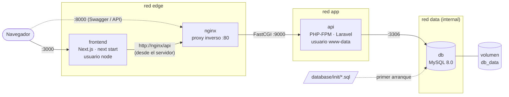

# Voltio en Docker — imágenes multi-stage y optimización de capas

**Autor:** José Manuel Calderón González

Ecosistema de producción de tres servicios desarrollados durante el bootcamp, contenerizados con **builds multi-stage** y orquestados con **Docker Compose**:

| Servicio | Proyecto de origen | Tecnología | Imagen final |
| --- | --- | --- | --- |
| Frontend | [Voltio](https://github.com/joscal06/tienda-vitals) | Next.js 16 (App Router), React 19, Tailwind 4 | `voltio/frontend:1.0` (node:22-alpine) |
| API REST | [E-commerce API](https://github.com/joscal06/swaggerapi) | Laravel 12, PHP 8.2, JWT, Swagger, Stripe | `voltio/api:1.0` (php:8.2-fpm-alpine) + `voltio/nginx:1.0` (nginx:1.28-alpine) |
| Base de datos | — | MySQL 8.0 | `mysql:8.0` (oficial) |

Todo el ecosistema se levanta con un solo comando: `docker compose up -d --build`.

---

## Arquitectura de contenedores



- **frontend** renderiza en el servidor (Server Components y Server Actions) y llama a la API por la red interna `http://nginx/api`. El navegador nunca habla con la API ni recibe el JWT (queda en una cookie httpOnly).
- **nginx** es el proxy inverso de Laravel: sirve los archivos estáticos de `public/` y pasa el resto a PHP-FPM por FastCGI. Es la única puerta de entrada a la API (puerto 8000 del host).
- **api** ejecuta Laravel en PHP-FPM. Al arrancar genera la caché de configuración y rutas, aplica las migraciones y carga los datos de ejemplo.
- **db** es la imagen oficial de MySQL 8.0 con un volumen persistente en `/var/lib/mysql`. El puerto 3306 **no se publica** en el host: solo existe en la red `data`, marcada como `internal`.

| Red | Servicios | Para qué |
| --- | --- | --- |
| `edge` | frontend, nginx | El frontend consume la API |
| `app` | nginx, api | Nginx habla con PHP-FPM; la API sale a Internet (Stripe) |
| `data` (`internal: true`) | api, db | Solo la API llega a MySQL; sin salida a Internet ni acceso desde el host |

El orden de arranque lo controlan los **healthchecks**: `db` saludable → `api` → `nginx` → `frontend` (`depends_on: condition: service_healthy`).

## Estructura del repositorio

```
.
├── docker-compose.yml          # Orquestación de los 4 contenedores
├── .env.example                # Variables documentadas (copiar a .env)
├── scripts/generar-env.sh      # Crea .env con claves aleatorias
├── database/init/              # Script SQL para /docker-entrypoint-initdb.d/
├── frontend/                   # Código fuente de Voltio (Next.js 16)
│   ├── Dockerfile              # Multi-stage: base → deps → builder → prod-deps → runner
│   └── .dockerignore
├── backend/                    # Código fuente de la API (Laravel 12)
│   ├── Dockerfile              # Multi-stage: php-base → vendor → api | web (Nginx)
│   ├── .dockerignore
│   └── docker/                 # nginx/default.conf, php/zz-produccion.ini, zz-pool.conf, entrypoint.sh
├── comparacion/                # Dockerfiles "básicos" de antes, solo para comparar
└── .github/workflows/docker.yml  # Build, docker compose up y pruebas en cada push
```

## Cómo ejecutar el ecosistema

**Requisitos:** Docker Engine 24+ (o Docker Desktop) con Docker Compose v2.

```bash
git clone https://github.com/joscal06/docker-multistage.git
cd docker-multistage

# 1. Variables de entorno: genera .env con claves aleatorias…
./scripts/generar-env.sh
#    …o cópialo y complétalo a mano (APP_KEY, JWT_SECRET y contraseñas)
cp .env.example .env

# 2. Construir las imágenes y levantar todo (espera a que estén saludables)
docker compose up -d --build --wait
```

| URL | Qué es |
| --- | --- |
| http://localhost:3000 | Tienda Voltio (frontend) |
| http://localhost:8000/api/products | API REST (a través de Nginx) |
| http://localhost:8000/api/documentation | Swagger UI de la API |
| http://localhost:8000/up | Estado de salud de Laravel |

Usuario de prueba que crea el seeder: `cliente@demo.test` / `password`.

Comandos útiles:

```bash
docker compose ps                 # estado y salud de los contenedores
docker compose logs -f api        # logs de Laravel (salen por stderr)
docker compose exec api php artisan migrate:status
docker compose down               # detiene todo; los datos de MySQL se conservan
docker compose down -v            # detiene todo y BORRA el volumen de datos
```

### Variables de entorno

Todas están documentadas en [`.env.example`](.env.example). Las imprescindibles son:

| Variable | Servicio | Descripción |
| --- | --- | --- |
| `MYSQL_ROOT_PASSWORD` | db | Clave de root de MySQL |
| `MYSQL_DATABASE` | db, api | Base de datos que se crea en el primer arranque |
| `MYSQL_USER` / `MYSQL_PASSWORD` | db, api | Usuario sin privilegios de administrador con el que se conecta Laravel |
| `APP_KEY` | api | Clave de cifrado de Laravel (`base64:` + 32 bytes aleatorios) |
| `JWT_SECRET` | api | Secreto con el que se firman los JWT |
| `NEXT_PUBLIC_STRIPE_PUBLISHABLE_KEY` | frontend (build) | Llave publicable de Stripe; opcional |
| `STRIPE_SECRET` | api | Llave secreta de Stripe; opcional (sin ella todo funciona menos el pago) |

`docker compose` se niega a arrancar si falta una variable obligatoria (`${VAR:?mensaje}`), así el error aparece antes de crear los contenedores.

---

## Decisiones técnicas

### Frontend — `frontend/Dockerfile`

| Etapa | Base | Qué hace |
| --- | --- | --- |
| `base` | `node:22-alpine` | Directorio de trabajo y `NEXT_TELEMETRY_DISABLED` comunes |
| `deps` | base | `npm ci` con **todas** las dependencias (hacen falta para compilar) |
| `builder` | base | Copia el código y ejecuta `next build`; borra `.next/cache` |
| `prod-deps` | base | `npm ci --omit=dev`: solo dependencias de producción |
| `runner` | base | Imagen final: `node_modules` de producción + `.next` + `package.json` + `next.config.ts` |

- **Solo lo necesario para `next start`.** La imagen final no tiene el código fuente (`src/`), ni TypeScript, ESLint, Tailwind u otras devDependencies, ni la caché de compilación. En `/app` solo quedan `.next`, `node_modules`, `package.json` y `next.config.ts`.
- **Caché de capas.** En `deps` y `prod-deps` se copian primero solo `package.json` y `package-lock.json`. Si cambia el código pero no las dependencias, Docker reutiliza la capa de `npm ci` y solo repite `next build`. Además, `RUN --mount=type=cache,target=/root/.npm` conserva la caché de npm entre builds sin meterla en la imagen.
- **Builds reproducibles.** `npm ci` instala exactamente lo que fija `package-lock.json`.
- **Binarios nativos.** El lockfile trae `@next/swc` y `sharp` para glibc y para musl. Alpine usa musl, así que `prod-deps` borra las variantes glibc, que nunca se cargarían.
- **Variables públicas en el build.** `NEXT_PUBLIC_STRIPE_PUBLISHABLE_KEY` llega como `ARG` porque Next.js la incrusta en el JavaScript del navegador al compilar. Las variables del servidor (`API_BASE_URL`, `SITE_URL`) se pasan en tiempo de ejecución desde `docker-compose.yml`, así que la misma imagen sirve para cualquier entorno.
- **Seguridad.** El proceso corre con el usuario sin privilegios `node` (`USER node`, archivos con `--chown=node:node`). En Compose el contenedor además pierde todas las capabilities de Linux (`cap_drop: [ALL]`) y tiene `no-new-privileges`. Los `.env` nunca entran al contexto de build gracias a `.dockerignore`.
- **Versión de Node.** La actividad recomienda `node:20-alpine`. Se usa `22-alpine` porque Node 20 dejó de recibir parches de seguridad en abril de 2026 y Next.js 16 pide Node ≥ 20.9. Se puede volver a la 20 sin editar el archivo: `--build-arg NODE_VERSION=20-alpine`.
- **Operación.** `HEALTHCHECK` contra `/api/health`. `CMD` invoca `next` directamente (sin `npm`) para que Node reciba `SIGTERM` y se detenga limpio.

### API Laravel — `backend/Dockerfile`

Un mismo Dockerfile produce **dos imágenes** (`target: api` y `target: web`) que comparten las etapas de build:

| Etapa | Base | Qué hace |
| --- | --- | --- |
| `php-base` | `php:8.2-fpm-alpine` | Instala `pdo_mysql` y `opcache`, y comprueba que estén cargadas `pdo_mysql mbstring openssl tokenizer xml ctype json` (si falta una, el build falla) |
| `vendor` | php-base + Composer | `composer install --no-dev` y autoloader optimizado (`--classmap-authoritative`) |
| `api` | php-base | Imagen final de PHP-FPM: código de la app + **solo `vendor/`** de la etapa anterior |
| `web` | `nginx:1.28-alpine` | Nginx con `default.conf` y únicamente la carpeta `public/` |

- **Extensiones.** La imagen oficial ya trae compiladas `mbstring`, `openssl`, `tokenizer`, `xml`, `ctype` y `json`; solo se compila `pdo_mysql` (más `opcache`). Las herramientas de compilación (`$PHPIZE_DEPS`) se instalan y se eliminan **en la misma instrucción `RUN`**, así no quedan en ninguna capa.
- **Composer solo en el build.** Composer se copia de la imagen oficial `composer:2` a la etapa `vendor` y no llega a la imagen final. Tampoco llegan `tests/`, `phpunit.xml`, la configuración de Vite ni las dependencias de desarrollo (PHPUnit, Pint, Sail, Pail…).
- **Caché de capas.** Primero se copian `composer.json` y `composer.lock` y se ejecuta `composer install --no-autoloader`. Si solo cambia el código, esa capa se reutiliza y solo se regenera el autoloader. La caché de Composer usa `--mount=type=cache`.
- **Configuración de producción.** Se usan `php.ini-production`, `expose_php = Off` y OPcache con `validate_timestamps = 0` (el código no cambia dentro de una imagen inmutable). El pool de FPM tiene `clear_env = no` para que Laravel vea las variables del contenedor, y expone `/ping` para el healthcheck.
- **Configuración en el arranque, no en el build.** `entrypoint.sh` valida que existan `APP_KEY`, `JWT_SECRET` y las credenciales de la base. Luego ejecuta `php artisan optimize` (caché de config, rutas, eventos y vistas con los valores reales del entorno), `migrate --force` con reintentos y, si `SEED_DATABASE=true`, los seeders, que son idempotentes. Así ningún secreto queda grabado en la imagen.
- **Seguridad.** PHP-FPM corre completo con `www-data` (`USER www-data`). Solo `storage/` y `bootstrap/cache/` tienen permisos de escritura. Los logs van a `stderr` (`docker compose logs`). En Compose se aplican `cap_drop: [ALL]` y `no-new-privileges`.
- **Nginx como proxy inverso.** Va en su propio contenedor: un proceso por contenedor, imágenes más pequeñas y escalado independiente. Solo ejecuta `index.php` (cualquier otro `.php` → 404), bloquea archivos ocultos (`.env`, `.git`), oculta su versión (`server_tokens off`) y la cabecera `X-Powered-By`, añade cabeceras de seguridad y comprime JSON con gzip. Su healthcheck consulta `/up` de Laravel, así comprueba la cadena completa Nginx → PHP-FPM.

### Base de datos — MySQL 8.0

- Imagen oficial `mysql:8.0` configurada solo con variables de entorno (`MYSQL_ROOT_PASSWORD`, `MYSQL_DATABASE`, `MYSQL_USER`, `MYSQL_PASSWORD`). Laravel se conecta con el usuario normal, no con root.
- Volumen con nombre `db_data` en `/var/lib/mysql`: los datos sobreviven a `docker compose down` y a la recreación de los contenedores.
- `database/init/01-inicializacion.sql` se monta en `/docker-entrypoint-initdb.d/` (solo lectura). Se ejecuta una sola vez, cuando el volumen está vacío: fija `utf8mb4` y registra la inicialización en la tabla `ecosistema_info`. Las tablas de la aplicación las crean las migraciones de Laravel.
- El puerto 3306 **no se publica** en el host y la red `data` es `internal`.
- El healthcheck con `mysqladmin ping` hace que la API no arranque hasta que MySQL acepte conexiones.

### Antes y después

En [`comparacion/`](comparacion) están los Dockerfiles "básicos" con los que trabajaba el equipo: una sola etapa, imagen base completa, `COPY . .` antes de instalar dependencias, devDependencies y herramientas en producción, y ejecución como root. El workflow de GitHub Actions construye las dos versiones y publica la comparación de tamaño y de tiempos de build.

### Resultados medidos

Datos de la ejecución [#3 del workflow](https://github.com/joscal06/docker-multistage/actions/runs/44178016611) (runner `ubuntu-24.04`; tamaños como los reporta `docker images`):

| Imagen | Básica (antes) | Multi-stage (después) | Reducción |
| --- | --- | --- | --- |
| Frontend Next.js | 1961 MB (`node:20`) | **511 MB** (`node:22-alpine`) | 74 % |
| API Laravel (PHP-FPM) | 681 MB (`php:8.2-fpm`) | **124 MB** (`php:8.2-fpm-alpine`) | 82 % |
| Nginx (proxy inverso) | — | 62 MB (`nginx:1.28-alpine`) | — |
| MySQL | — | 799 MB (`mysql:8.0` oficial, sin construir) | — |

| Tiempo de build | Básico | Multi-stage |
| --- | --- | --- |
| Inicial, sin caché (frontend + API) | 96 s | 74 s |
| Tras cambiar una línea de código | 58 s | **12 s** (`npm ci`, `composer install` y la compilación de extensiones salen de la caché: 19 pasos reutilizados) |

## Verificación automática (GitHub Actions)

[`.github/workflows/docker.yml`](.github/workflows/docker.yml) se ejecuta en cada push y:

1. Genera un `.env` con claves aleatorias y valida `docker-compose.yml`.
2. Construye los Dockerfiles básicos y los multi-stage, midiendo tiempo y tamaño.
3. Ejecuta `docker compose up -d --wait`.
4. Prueba la API (catálogo, login JWT, `/api/auth/me`, Swagger), el frontend (portada y detalle con productos leídos de MySQL a través de la API) y la persistencia del volumen (crea un usuario, `docker compose down`, `up` y vuelve a iniciar sesión).
5. Publica como anotaciones: tamaños antes/después, extensiones PHP, usuarios de cada proceso, contenido de las imágenes finales, puertos publicados, ejecución del script de inicialización y la prueba de caché (cambia una línea de código y reconstruye: `npm ci` y `composer install` salen de la caché).
